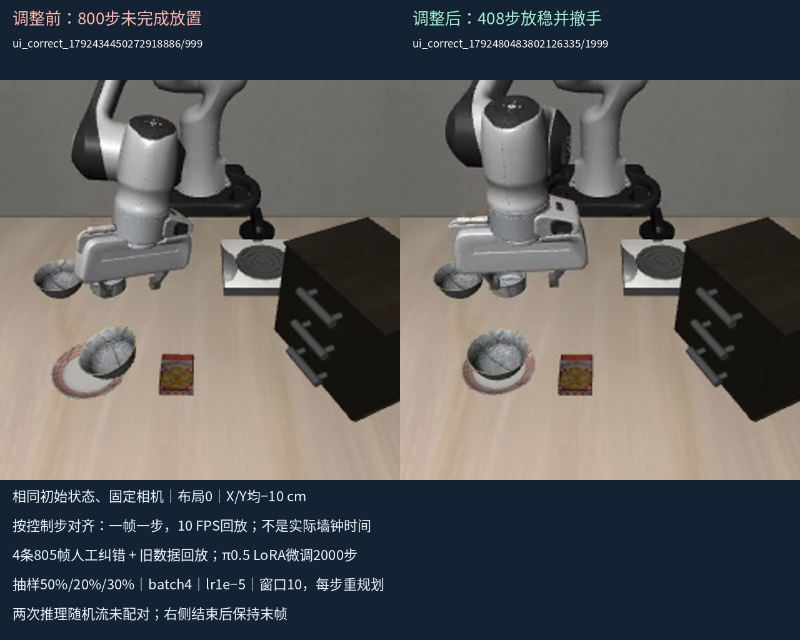

# 同一位置调整前后：人工纠错＋π0.5 LoRA 微调

## 先看左右并列视频

- [▶ 面板＋MuJoCo原速左右对比（推荐，2560×1024）](https://github.com/sencangWei/pi05-handson/releases/download/demo-comparison-20261020/negative10-gui-before-after.mp4)：左旧模型、右新模型；X/Y都为−10cm，同一个初始物理状态文件。按日志中点击“运行”的时刻近似对齐，保留过程原速，不删除中段。右侧先结束后显示“已成功结束｜保持末帧”，没有循环播放或伪造后续动作。原始录屏启动/编码延迟和不同相机旋转使这不是精确耗时基准。
- [▶ 固定相机、按控制步同步对比（抓取/放置看得更清楚）](https://github.com/sencangWei/pi05-handson/releases/download/demo-comparison-20261020/negative10-camera-before-after.mp4)：相同两条真实轨迹，每帧一个控制步，10 FPS播放，省略推理等待，不代表真实墙钟速度。起点均为控制步0，短的一侧保持最后画面。
- [本机交互观看页](index.html)；[全部原始录屏与对比下载](https://github.com/sencangWei/pi05-handson/releases/tag/demo-comparison-20261020)。原始MP4逐字节保留。

## 你新录的三条，我检查到了什么

| 原始Demo | 初始状态编号 | 碗X/Y偏移（厘米） | 实际策略控制步 | 末尾60步复核 |
|---|---:|---|---:|---|
| [新录1：原片](https://github.com/sencangWei/pi05-handson/releases/download/demo-comparison-20261020/after-near-negative-demo1-original.mp4) | 0 | −6.743215 / −9.164927 | 408 | 碗在盘上、开爪、撤离≥10cm，持续稳定通过 |
| [新录2：原片](https://github.com/sencangWei/pi05-handson/releases/download/demo-comparison-20261020/after-near-negative-demo2-original.mp4) | 0 | −6.743215 / −9.164927 | 446 | 同上，通过 |
| [新录3：原片](https://github.com/sencangWei/pi05-handson/releases/download/demo-comparison-20261020/after-negative10-original.mp4) | 0 | −10 / −10 | 408 | 同上，通过 |

三条均核对为新模型 `ui_correct_1792480483802126335/1999`，参数manifest SHA256为 `7f663fea182ef9ba232d3aa78697644dbc5f7dff54370451fa6a68972af028f6`。动作日志逐条重算，末尾60步全部满足On、开爪指令、真实夹爪间隙≥6cm、末端距碗≥10cm，碗位置漂移≤5mm；不是只凭On=True判成功。录制时的场景日志只有reset、录屏、run、saved，无人工接管/改动物体状态记录。人工视觉检查每条20帧固定相机画面及6帧程序窗口画面，覆盖起点、抓取、搬运、放置、撤手；未宣称逐帧目检。

这是用户提供的三条录像都通过，**不是随机抽样的整体3/3成功率，更不是跨场景泛化证明**。第一、二条同一位置，推理随机流不同，不能算两个新位置。

## −10/−10的前后匹配证据

- 左：[旧模型原始失败录屏](https://github.com/sencangWei/pi05-handson/releases/download/demo-comparison-20261020/before-negative10-original.mp4)，`ui_correct_1792434450272918886/999`，800步达到预算，未触发On，未完成放置。
- 右：你最后录的新Demo，`ui_correct_1792480483802126335/1999`，408步完成放置、松爪、撤手，并保持60步稳定。
- 两者 `initial_state.npy` 文件完全相同，SHA256均为 `59ca17aa32bef24020a68d05623b0489aab5a6fde64d1b9278394a64f5a9ec01`。任务文件、状态编号0、仿真seed42、X/Y=−0.1m、归一化、每步重新规划、最多800步相同。
- 旧录像的真实现象是**能抓起，但碗倾斜、对盘/放置失败后没有完成恢复**，不能标成“从头到尾抓不到碗”。其后人工接管发生在录屏停止约11分钟后，是训练数据采集，不在左侧原始失败视频内。
- 两次GUI服务器都从推理seed0开始，但重置布局不重置策略采样RNG，前序轨迹不同，所以**这个用户录屏对比只保证初始物理状态相同，不保证策略随机序列相同**。先前另有固定每连接seed0/1的配对评测，见下文。
- 录屏原片约103.267秒与53.667秒，长的一条因800步失败预算结束。不能由一条失败和一条成功直接推出“速度提升一倍”。

## 具体采取了什么处理措施

### 1. 从实际失败状态采集人工纠错动作

针对负向边缘区域，补充4条已批准的连续纠错轨迹，共805个实际控制帧。内容包括开爪/调整、重新抓稳、抬起移动、对齐盘子、精细下降、松爪和撤手；部分片段有重新夹取。训练使用两路RGB及逐帧真实动作标签。视频用于回看，未把MP4加速当作训练动作，也没有把不相邻动作拼接成一段。

原始纠错与训练输入可追溯：[人工片段检查](../edge-recovery-20261020/review/index.html)、[选择清单](../curation-edge-recovery-v1-selection.json)、[训练输入清单](../corrections-edge_recovery_focus_20261020-manifest.json)。

### 2. 新纠错重点抽样，同时回放所有旧数据

此前47条/6126帧的导出文件逐字节保留，加上新805帧后为51条/6931帧。实际抽样目标：

| 训练来源 | 实际帧数 | 抽样概率目标 |
|---|---:|---:|
| 公开示范37条 | 4400 | 50% |
| 之前批准的人工轨迹/连续片段10条 | 1726 | 20% |
| 新负向边缘纠错4条 | 805 | 30% |

所有6931个真实观测起点都保留，通过200000个虚拟起点索引重复/打乱来增加新纠错曝光，比例是长期抽样目标，不是每个batch强制分配。这样既学习新纠错，又回看旧任务，但不能保证没有遗忘，也没有凭空增加新场景覆盖。原始数据和草稿没有删除。

### 3. 从旧模型继续进行监督模仿学习的LoRA微调

| 配置 | 本轮实际值 |
|---|---|
| 模型 | π0.5，OpenPI固定源码；仅更新LoRA |
| 初始化父模型 | `ui_correct_1792434450272918886/999`全部模型权重 |
| 训练产物 | `ui_correct_1792480483802126335/1999` |
| 新增参数更新 | 2000次，非仿真动作2000步 |
| Batch | 4个动作窗口/更新，共处理8000个窗口，含重复 |
| 学习率 | 1e-5，20步warmup后固定 |
| 优化器 | AdamW，梯度范数裁剪1.0；新建优化器/调度器/RNG/游标，不是完整断点续训 |
| 训练随机种子 | 42 |
| 动作 | 7维，预测未来10步；仿真执行1步后重新观察规划 |
| 归一化 | 沿用父模型统计，不重算、不放大动作 |

这属于**人工示范监督微调/模仿学习**，不是强化学习，也不是仅修改UI移动步长或给夹爪加一条强制松手规则。[完整实际启动配置](../edge-recovery-20261020/actual-launch-config.json)、[训练日志](../edge-recovery-20261020/training.log)、[已备份的LoRA权重及恢复验证](https://github.com/sencangWei/pi05-handson/releases/tag/edge-recovery-20261020)。这三条用户新录Demo的权重哈希相同，录制之间没有再次训练。

### 4. 用固定条件评测，再查看实际窗口复测

训练前固定的同状态、同推理seed0/1配对评测中：−10/−10位置严格通过1/2→2/2，总体7/10→8/10；四个开发对照总计6/8→6/8，但有单条退步。两模型均通过的五组中，新模型动作步数仍更长，不能宣称全部变快或所有恢复已修好。新模型仍有一条盘上不松爪，另一条碗稳定但出现一次闭爪命令而未过严格门限。[包含所有失败和控制条件的完整报告](../edge-recovery-20261020/README.md)。

本页只展示与已记录措施一致的真实前后实例。没有仅凭这几条录像将收益归因于“抽样比例”或“2000步”单一因素；它们同时改变，且没有做消融实验。

## 文件、制作与核验

- `sources.json`：模型身份、原始路径、偏移、输入文件哈希、运行时刻、录像采样检查索引。
- `records/`：4个场景的原始动作CSV、时序、结果、相机视频、初始/末尾状态和录屏元数据，供重算与对齐。
- `source-verification.json`：三个新Demo的60步收尾复核和同初始状态检查。
- `build_comparisons.py`、`render.json`：真实FFmpeg参数、原速/控制步同步方式、两侧结束和保持末帧时刻。
- `media-verification.json`：输出解码/帧数/尺寸/时长检查和资产SHA256，原片与对比均保留。
- `remote-media-restore.json`：从GitHub下载全部6个视频后逐字节哈希核对。
- `homepage-verification.json`：仓库默认分支`main`的观看入口已发布，重新读取README后逐字节比对。

发布核验完成：公开Release包含三条新原片、一条旧失败原片和两版左右对比，共6个MP4。全部重新下载，文件大小及SHA256与本地已核验素材一致；原片未重编码。代码、场景记录和制作说明位于`experiment/correction-learning`分支，默认首页已链接到本次发布页与报告。

制作复现：下载本次release的四个`*-original.mp4`到`exports/demo_comparison_20261020/`，在项目根目录运行 `.venv-sim/bin/python evidence/demo-comparison-20261020/build_comparisons.py`。已存在对比文件会拒绝覆盖；可用`--output-dir`指定含四个原片的新目录。需要FFmpeg和已安装的NotoSansCJK字体。源录像未加速、不删中途失败/调整、不循环短侧、不合成机器人动作。
