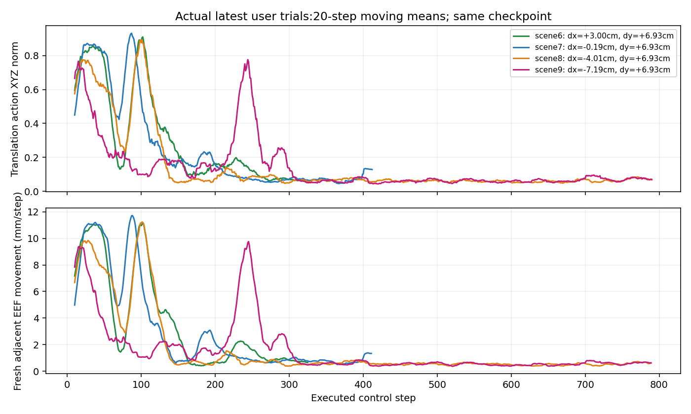

# 负位移后近乎停滞：2026-10-19 最新亲测诊断

状态：**行为缺陷未修复，诊断已取得直接证据；本次没有再次启动训练。** 当前GUI和模型服务保持，原始记录未修改。

## 已确认

| 场景 | GUI X偏移 | Y偏移 | 发生变化 | 实际后续行为 |
|---|---:|---:|---|---|
| 006 | +3.00cm | +6.93cm | 成功放置 | 开爪留盘、撤手 |
| 007 | -0.19cm | +6.93cm | 成功放置 | 实际碗世界X仍为正；开爪留盘、撤手 |
| 008 | -4.01cm | +6.93cm | 约150步后明显变慢 | 携碗闭爪缓慢漂出盘区，800步未On |
| 009 | -7.19cm | +6.93cm | 约300步后明显变慢 | 携碗闭爪缓慢漂移，800步未On |

008在101–150步的XYZ动作范数均值0.366，151–200步降至0.0628；连续post位置移动从4.90降到0.591毫米/步。009的251–300步从3.085毫米/步，301–800降至0.553毫米/步。动态视频和动作均支持已抬碗，不能描述成全程空夹。

图使用相邻fresh pre-state；独立目视报告还给出相邻post-state口径，二者采样时刻不同，不混做同一步pre/post位移。两种一致时刻口径均显示下降。

## 软件和物理对照

当前执行链未发现负X/Y截断、反号或按坐标符号限速；归一化正逆无clip，OSC XYZ限幅对称、position_limits=None。state=False与固定OpenPI官方pi05_libero配置一致，不能直接认定为课程配置错误。详见[源码核对](code-audit.json)。

两失败运行800步分别约164.33和164.09秒，正位置336步约68.82秒；持续运行吞吐均约4.9控制步/墙钟秒。该时间来自run到save，可能含用户延迟，不能用它推定每步精确延迟；近停阶段可由模型小动作直接解释。

在隔离仿真中，各恢复同一末状态，独立比较30步：

| 末状态 | A：回放原末30个模型动作，碗距盘变化 | B：固定小幅朝盘诊断动作，碗距盘变化 |
|---|---:|---:|
| 008 | +17.11mm（远离） | -48.85mm（靠近） |
| 009 | +16.56mm（远离） | -44.73mm（靠近） |

末状态控制器仍可朝盘运动，支持未物理卡死；最小关节限位裕量分别约1.019/0.845rad，采样仅见碗与夹爪接触。该探针只覆盖末状态，不能排除更早阶段的接触影响。控制器内部状态未原样序列化，使用已验证的缓存/目标/夹爪累加器一致恢复；两支采用相同恢复过程。**B是外部诊断控制，不是模型恢复能力，不进入训练。**详见[120控制步探针](physical-probe.json)。

## 结论与下一轮边界

故障已定位到策略行为：特定抓取后状态持续给小幅XYZ、保持闭爪，且移动方向未把碗送盘；增加仿真观察上限本身没有被验证为修复。当前证据仍不足以把深层原因唯一归于数据量、数据冲突、训练不足或过拟合。

上一轮仅两条新teacher的搬运速度对照，已被实际结果否定为全面修复。下一轮应先核对负位移完整成功路径和停滞后纠正的样本覆盖、时序与动作冲突，再准备针对性专家轨迹；完整人工原件继续保留。验收应加入X负/Y正、X正/Y负及双负的合法物理位置，分别报告完整松爪撤手和速度，另用未参与训练的位置检查泛化。数据质量门通过前不继续盲目加训练更新或整体放大执行动作。

[source-trials/](source-trials/)保存最新4条原始记录逐字节副本。[独立目视](visual-review.json)、[故障回归输入](regression-cases.json)。这些失败策略动作仅作为评测证据，training_allowed=False，不能冒充专家标签或已批准人工纠正。GUI策略随机数跨轮推进，现有四条观察相关性不等价于坐标符号的独立因果试验。
