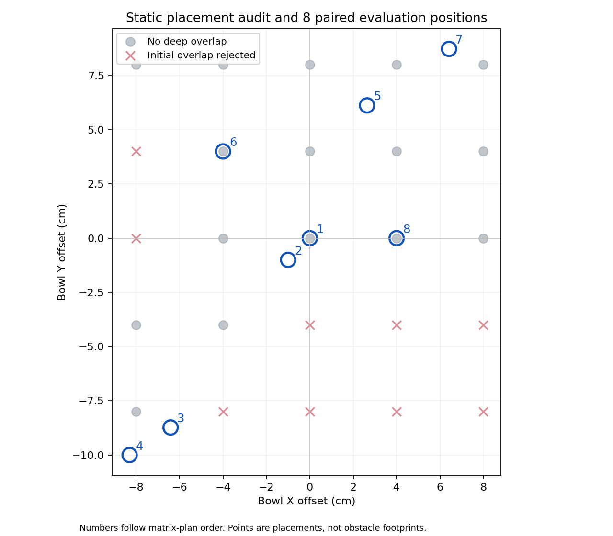

# 碗位置、慢动作与恢复问题：实际仿真调查

2026-10-19。用户授权自主调整位置、观察机械臂、分析原因并安排重训。

## 结果入口

- [三模型逐位置同步录像](index.html)：每行一个位置，三栏按控制步同步播放，可暂停、拖动和调播放倍率。**视频在本机，不在远端仓库**。
- [逐运行指标和哈希](metrics.json)、[冻结的实验计划](matrix-plan.json)、[重训安排](retraining-plan.json)。
- 本机原始录像、动作CSV、物理初末状态和双相机图：`.local/position-study-v1/runs/`。

## 实际做了什么

先检查25个规则网格位置和6个现场位置，拒绝深度超过1毫米的初始物体重叠。网格中16个通过、9个碰撞。随后在查看策略结果前固定8个合法位置，对父模型、均匀采样微调和最新分阶段采样微调做 **24次真实 MuJoCo 闭环仿真**，另做2次原始人工动作重放预检。

使用独立离屏仿真，不是伪造动画或GUI点击记录。物理引擎、双相机观测和每步重新预测逻辑与交互面板一致；保留原GUI场景和8755模型服务。每条独立客户端连接将诊断策略RNG固定为0，同位置三模型使用相同物理初态；同一输入连续两次5步测试动作完全一致。诊断服务用8756，结束时仅关闭自建服务。

| 名称 | checkpoint（`checkpoints/pi05_handson_lora/` 下） | 含义 |
| --- | --- | --- |
| parent1999 | `ui_correct_1792311653585294069/1999` | 后两分支共同父模型 |
| uniform4999 | `ui_correct_1792324180062259097/4999` | 公开+已审人工示范按帧均匀抽样 |
| tempo4999 | `ui_correct_1792341395770417042/4999` | 最新70/10/19/1分阶段抽样 |

固定layout24、物理seed42、策略seed0、预测10步但每次只执行第1步，然后读取新观测。每条最多800控制步；成功门为连续10步同时满足：实际On、开爪指令、实际夹指开度≥6厘米、末端离碗≥10厘米。首次达到才停止。单独On不代表放手完成。

## 位置与结果



坐标是相对原碗位置的偏移，单位厘米；不是相对盘子的距离。图中数字与下表对应。

| 位置 | ΔX, ΔY / cm | parent1999 | uniform4999 | tempo4999 |
| --- | --- | --- | --- | --- |
| 1. zero | 0.00, 0.00 | 完成 176 | 完成 269 | 完成 262 |
| 2. small_neg_neg | -1.00, -1.00 | 完成 132 | 完成 353 | 未完成 800（On=True） |
| 3. user054_neg_neg | -6.42, -8.73 | 未完成 800（On=False） | 未完成 800（On=False） | 未完成 800（On=False） |
| 4. user055_neg_neg | -8.31, -10.00 | 未完成 800（On=False） | 未完成 800（On=False） | 未完成 800（On=False） |
| 5. user057_pos_pos | 2.64, 6.12 | 完成 213 | 完成 258 | 完成 225 |
| 6. neg_pos | -4.00, 4.00 | 未完成 800（On=False） | 完成 307 | 未完成 800（On=False） |
| 7. mirror054_pos_pos | 6.42, 8.73 | 完成 177 | 完成 518 | 未完成 800（On=True） |
| 8. pos_zero | 4.00, 0.00 | 完成 141 | 完成 336 | 完成 305 |

表中`On=True`表示过程中曾触发，不表示末帧仍成立。最新模型在镜像正正位置第326步曾On，但第800步末帧已为False；完整释放门始终未通过。所有“完成”后的数字均为已执行控制步数。

本组固定案例完整释放撤手数：父模型 **5/8**，均匀模型 **6/8**，最新模型 **3/8**。这不是泛化成功率：只有一个策略种子、一个基础布局，且这些位置已经用于问题调查。正X负Y的一些候选摆放会穿透盘子，本组没有合法的第四象限配对案例，不能外推该象限。

**最新采样方案未通过本组验证。** 它在小双负和镜像正正位置未能维持原有完整释放结果；普通搬运也仍慢。不能把这次5000步训练汇报为问题已经解决。均匀模型在本组多完成一个位置，但也较慢，不能只凭6/8就称其具备可靠恢复能力。

## 为什么会慢：证据与边界

### 1. 确有初始摆放缺陷，但不解释全部问题

旧scene050/051让碗与盘子重叠约7.1/8.1毫米。独立零平移动作实验中，碗会自行移动约20.8/48.5毫米，证明物理碰撞本身足以改变初态。已在`move_bowl`增加穿透检查，拒绝时精确恢复原qpos/qvel，不推进物理步骤。微米级正常桌面接触不拒绝。

scene054/055是合法摆放，仍有问题；`(-1cm,-1cm)`也是合法双负位置。因此不能把所有双负失败归因于穿模或负号。详见[穿透修复与独立对照](../phase-tempo-failure-v1/README.md)。

### 2. 要分清“抓不起来”和“抓住后搬得慢”

父模型在远端054/055位置800步内未出现碗抬高2厘米，已不是只等最后松手的问题。其他位置还会出现抬起但没放到On的情况。每条的首次闭爪、抬碗、On、完整释放时间都在`metrics.json`；其中抬高/闭爪只用于诊断，不能单独认证抓稳。

下面是搬运代理段的相邻新鲜末端观测位移中位数，单位 **毫米/控制步**。代理条件：闭爪指令、碗高于初态3厘米、尚未On；只统计相邻两步都满足的区间，因此接触、停顿和掉碗仍需看录像。

| 位置 | parent1999 | uniform4999 | tempo4999 |
| --- | --- | --- | --- |
| zero | 10.50 | 1.83 | 1.31 |
| small_neg_neg | 10.23 | 0.77 | 1.04 |
| user057_pos_pos | 10.18 | 1.63 | 4.07 |
| mirror054_pos_pos | 10.30 | 0.76 | 0.70 |
| pos_zero | 10.58 | 0.52 | 0.72 |

不能把这些数当纯运输速度或用成功子集包装整体提速。普通搬运慢也发生在正偏移位置，符号不是可靠的故障开关。末端已经放碗后的小动作应与普通搬运分开；“全程最后100步很慢”不足以判断搬运失败。

本组最新模型在小双负位置第279步已On，仍运行到800步而未通过释放门：最后10步全是闭爪，实际夹指开度约10.9毫米，末端距碗约50.6毫米。这是“已到盘仍未释放”的直接例子，不能只归结为220步强制截停；但也未证明无限运行永不恢复。相反，均匀模型远负055到第733步才出现抬碗代理，800步停止确实会截去后续机会；两类情况必须分开。

### 3. 人工动作幅度与覆盖存在明确限制

17条批准原始录制整理为19段训练片段；加上37条公开示范，共13521帧，其中人工9121帧。草稿不纳入，全部原件与批准恢复片段保留。人工XYZ动作范数几乎都≤0.1，公开动作中位数约0.80；在按帧均匀混合时，人工帧约占67.5%。之前固定观测检查也发现后续模型更接近这些小动作标签。这支持数据风格影响速度，**不能单凭此证明过拟合或唯一根因**。

负负偏移的人工示范确实存在，不是完全没采过；但很多是从人工接管的中途姿态开始。碗XY接近不等于覆盖从默认起点到该位置的整条接近、抓取和恢复路径。详见[训练覆盖审计](training-coverage.json)。

最新抽样只把明确标出的1261个慢搬运起点降至1%；其余6794个人工帧属于“接触及其他”，并非全部已认证精细接触。全局比例变化不保证每一种视觉状态都有足够的正常搬运目标，因此不能将该配比视为已经验证的修复。

### 4. 更正模型输入说明

此前将记录的8维状态说成当前模型的条件输入并不准确。实际`pi05=True, discrete_state_input=False`，当前模型使用 **RGB+文字**，8维状态虽保存、传递和归一化，但没有进入条件token。场景偏移dx/dy数值也没有直接传给策略。这个配置沿用官方LIBERO路径，不是新出现的代码回归；它是值得另做实验的能力限制，尚未证明是本次慢动作的唯一原因。

没有发现新的RGB翻转、动作单位、公开数据标签错配或轴角跳变证据。轴角分量超过π并不自动意味着错误。不能只在推理时打开状态开关，必须训练与推理配置一致。

## 为什么本次没有直接再训一轮

单纯继续调抽样比例、叠更多更新不能同时补齐抓取覆盖和可靠提速标签。先按[重训安排](retraining-plan.json)检查旧轨迹能否用于物理重采。

实际对两条已批准的完整原件做1x原动作重放：

| 原始示范尾号 | 步数 | 终点完整释放门 | 相对原记录末端轨迹平均误差 |
| --- | --- | --- | --- |
| 6444273677599 | 796 | 通过 | 54.0毫米 |
| 6988593839967 | 735 | 未通过，On为假 | 48.9毫米 |

动作逐帧与原件完全一致，起始物理状态精确恢复，首帧状态误差很小，但随后轨迹偏离。新建控制器的目标仍在home附近，旧的控制器/夹爪内部状态没有被完整保存，是明确混杂因素，不能宣称它是唯一原因。**当前原速重放预检不通过，不生成2x轨迹，不拿错位RGB和动作训练。原录制当时的正确帧仍保留，此结果不等于判废原人工数据。**

详见[实际重放报告](original-replay-pilot.json)。CSV/NPZ/真实初末双相机图在本机`.local/position-study-v1/original-replay-pilot/`；[原样诊断脚本](original-replay-pilot/replay_controls.py)供复盘，不作为一键重训入口。

## 下一轮重训的执行顺序

1. **先补可验证的数据路径。** 修正并验证控制器恢复，或在连续新仿真中生成新的成功teacher轨迹；用2条原速控制先验真。只有通过后，才在已审普通搬运段尝试2x参考进度，重新实际执行并采集匹配的双RGB、状态和动作。抓/放接触、恢复段保持原节奏；目标是实际搬运用时至少改善1.5倍且不掉碗。不能仅剪帧、加速视频或把旧动作标签乘倍数。
2. **远端合法位置单独补连续抓取覆盖。** 优先复用完整原件；如没有从home到抓取的可靠路径，就需要少量针对这些位置的连续成功示范，或独立验证的仿真teacher。单独加速已抓住碗的片段不能补出缺失的抓取动作。恢复片段全部保留，不要求全部重录。
3. **数据通过后再做一个受控训练。** 暂定同一共同父模型1999，batch4、学习率1e-5、seed42、先2000次新更新、比较1000和1999 checkpoint；10步动作窗口、每步闭环执行、保持归一化和当前state条件不变。这样先比较数据改动，避免把旧分支累计训练量混进去；2000不是保证足够。新数据的阶段权重等真实数量和质量确定后再冻结，不再凭总帧数拍比例。
4. **按位置验收。** 零偏移、两个合法远负位置、一个正偏移，用3个策略种子，对照/候选共24次；已成功位置不退化，远端必须真正抓起并释放。完整释放门后另有界追加50步，观察重抓/漂移；失败800步计为未完成，不能从提速统计中悄悄剔除。另保留至少2个未用于生成或选模型的新合法初态作最终确认；已有10条公开留出不进训练。
5. **状态条件作为独立后续A/B。** 如果图像/阶段歧义仍存在，另训`discrete_state_input=True`并匹配推理配置，先检查token量化范围与截断。不能同时改数据、状态输入和训练预算后声称某一项起效。

本次已完成调查和参数/数据验收安排；**没有启动新训练，没有声称模型已修好，也没有生成自动批准的teacher数据**。新teacher必须如实标明`offline_tracking_teacher`，不能伪装成人工批准片段。

## 重放与文件核验

在项目根目录重新生成本机对照页（不启动模型、不运动）：

```bash
.venv/bin/python scripts/summarize_position_study.py
xdg-open evidence/position-study-v1/index.html
```

诊断策略服务与离屏重放的实际入口是`serve_position_study.py`和`replay_saved_scene.py`。需使用新输出目录；原始物理初态、权重和视频保留在本机。完整场景/模型身份、任务BDDL和初态SHA、RNG重置证据见`matrix-plan.json`、`matrix-results.json`和`metrics.json`。恢复的是物理积分状态，不声称精确复制GUI控制器历史或其已推进的策略RNG。

本轮单元验证：`test_simulation_lab.py`、`test_correction_workbench.py`、`test_summarize_position_study.py`共50 tests、5 subtests通过，本轮目标源码/测试文件Ruff通过；汇总独立重算24条CSV事件/初态哈希和结果一致。MP4另做实际解码帧数/FPS、首末帧可读与SHA检查，见`video-audit.json`。页面JavaScript语法和视频路径已检查，浏览器按钮逐项实测仍有缺口，不将其写成已通过的浏览器验收。

修复源码已写入；调查保留了你原来运行中的GUI，所以旧窗口尚未载入新的摆放检查。下次关闭旧窗口并按原入口重新打开，才会加载新版。没有修改当前GUI所选模型或中断其他GPU任务。

本轮交付的备份目标为`https://github.com/sencangWei/pi05-handson`的`experiment/correction-learning`分支。交付检查要求用远端重新fetch的补丁，在干净基线的新worktree恢复，比较完整git tree与交付文件SHA；独立完成证明由发布检查写入本机`.local/position-study-v1/remote-restore-proof.json`，仅当其中status为PASS才表示已验真。源码与指标入Git，原始权重、示范与本轮录像仍在本机。
