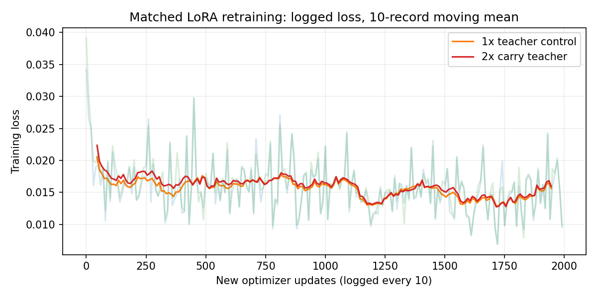

# 2026-10-19 重训练与真实仿真验证

## 结果

**两组各追加2000次LoRA更新、24次配对仿真全部完成。2x候选未通过“整体修复慢动作/负位移”的验收。**

- 原速对照、快搬运候选均6/12完成放置、实际开爪、撤手，并保持额外50步；两组均在零位移和正向位置3/3完成，在两个负向位置各0/3完成。
- 双方都完成的6对中，候选2对更快、4对更慢。zero的seed0从363步变为233步，seed2则从154变为230步；正位置三种子均更慢。不能把第一条提速推广为所有位置都变快。
- 成功后的12条50步随访均保持On、开爪命令、实际间隙≥6cm、手碗距离≥10cm，未重新闭爪。这只是固定50步内的观测。
- 两个负位置的12条运行截至800步均未完成。seed0独立目视发现：较长接近后能抬起碗，随后持碗偏向后方，未送盘；并非全程夹不到，也不能概括成统一松手故障。800步是观察上限，不证明以后永远无法完成。
- 这是4个已见开发验证位置×3个策略采样种子，训练每臂仅seed42一轮；不能作为未见位置泛化率或训练随机性统计结论。未做执行途中外力扰动，因此不能据此宣布抗扰恢复能力已学会。

**建议：暂不把2x候选作为全面修复版。下一轮优先补两个失败位置从起始姿态到抓取、送盘、松手撤手的完整成功轨迹，再在未参与采集的位置验证；同时保留现有人工纠错。现有结果不足以把原因唯一归于过拟合或训练次数。**

## 逐场景真实控制步

表中为首次连续10步满足On+开爪命令+实际间隙+撤手的控制步数；达到后再执行50步策略动作。失败不代入800计算完成时间均值。

| 位置 | 策略seed | 原速对照 | 快搬运候选 |
|---|---:|---:|---:|
| zero | 0 | 363 | 233 |
| zero | 1 | 324 | 289 |
| zero | 2 | 154 | 230 |
| user054_neg_neg | 0 | 800步未达（右删失） | 800步未达（右删失） |
| user054_neg_neg | 1 | 800步未达（右删失） | 800步未达（右删失） |
| user054_neg_neg | 2 | 800步未达（右删失） | 800步未达（右删失） |
| user055_neg_neg | 0 | 800步未达（右删失） | 800步未达（右删失） |
| user055_neg_neg | 1 | 800步未达（右删失） | 800步未达（右删失） |
| user055_neg_neg | 2 | 800步未达（右删失） | 800步未达（右删失） |
| user057_pos_pos | 0 | 213 | 268 |
| user057_pos_pos | 1 | 247 | 271 |
| user057_pos_pos | 2 | 181 | 222 |

## 查看视频与证据

- [左右同步对照Demo：zero / seed0](zero-seed0-comparison.mp4)：使用预声明的第一个位置/种子，没有按最佳成绩挑选。候选结束后冻结末帧并标注FINAL FRAME HOLD；原始动作和视频保持原样。两边每帧对应同一控制步，10FPS回放，不含推理等待，**不代表真实墙钟速度**。物理控制dt为0.05秒，因此此回放为物理仿真半速。
- [24次原始运行](../../evaluations/retrain-20261019/)：每次含actions.csv、result.json、物理初末状态和video.mp4。动态视频仅全局视角，腕部仅初始截图。
- [完整配对分析](followup-summary.json)、[真实视频/模型哈希核验](artifact-verification.json)、[8段独立目视报告](policy-visual-review.json)。抓稳不能只用“碗升高”代理确认，单视角遮挡仍有局限。
- [原速成功关键帧](visual-review/control__seed0__zero.png)、[候选成功关键帧](visual-review/candidate__seed0__zero.png)、[负位置失败关键帧](visual-review/candidate__seed0__user054_neg_neg.png)。

## 训练交付

| 组 | 本机checkpoint | 更新数 | 最后记录loss（1990步） |
|---|---|---:|---:|
| 原速对照 | `checkpoints/pi05_handson_lora/retrain_teacher_1x_20261019/1999` | 2000 | 0.0096 |
| 快搬运候选 | `checkpoints/pi05_handson_lora/retrain_teacher_2x_20261019/1999` | 2000 | 0.0098 |

checkpoint索引1999表示完成2000次新更新。使用同一既有父模型权重，分别fresh optimizer；不是从零预训练，也不是精确resume。batch4意味着每次更新4个观察起点及各自10动作标签，不是4轮。

[训练摘要](training-summary.json)、[控制启动记录](../retrain_teacher_1x_20261019-launch.json)、[候选启动记录](../retrain_teacher_2x_20261019-launch.json)。训练loss只说明训练目标拟合，不等价于成功率；未测监督留出loss，不能据此判断是否过拟合。



## 当前软件状态和备份范围

评测后恢复训练前的8755推理模型以保留GUI当前轮的模型身份；新checkpoint已经保存，供新一轮场景选择。当前GUI没有热更新；刷新列表不等于已载入新模型。“启动所选模型”会保存并关闭当前场景，活动纠错需先完成。[GUI边界核对](gui-restore-review.json)、[服务恢复核验](service-restored.json)。旧WebSocket若首次运行报连接错，会暂停并清旧连接，再运行才重连；没有用单步尝试来探测连接。

本轮代码、配置、完整原始评测视频/CSV、训练日志与报告备份到用户公开仓库的`experiment/correction-learning`分支。大体积原始训练RGB数据、生成teacher和完整checkpoint留在本机，未声称已推入Git。四个评测初始物理场景另有[逐字节快照](scene-snapshots.json)，位于`scenes/`；原结果中的绝对来源路径作为历史溯源保留。[代码阶段恢复验证](code-backup-proof.json)只对应其所写commit，最终交付另有本机远端恢复证明。

## 本轮干预

同一父模型 `ui_correct_1792311653585294069/1999`，两臂分别从相同权重重新初始化优化器，2000次新更新、batch4、LR1e-5、seed42、预测窗口10、state条件仍False。保留原37公开+17个人工原件整理出的19段，共13521帧，以及10条排除的公开留出。

仅新增两条来源一致、重新执行物理仿真采集的teacher。控制使用原速1x（新增1531帧，总15052帧），候选只在已审普通搬运区间内部用2x参考进度（新增1394帧，总14915帧）；两者抓/放/恢复段逐步使用原动作，起终物理场景相同。双RGB、pre-state、actualaction、post-state均重新采集，非复用旧画面乘动作标签。生成数据明确 `offline_tracking_teacher`、`human_actions_only=False`，不伪装人工批准。

原速回放先修复了控制器缓存与目标恢复。初版生成器在全程加入追踪反馈，改变抓取接触导致一条滑移，按原门拒绝；v2只在搬运段追踪，匹配控制和候选四条均通过原质量门。两条实际搬运控制步分别160→90、154→87，约1.77x；**这是生成示范的提速，不是模型已学会的提速**，整条仅小幅提速。失败原件仍保留，未进入训练。

两组采用相同60%公开、20%全部批准人工、15%teacher明确搬运、5%teacher其他的起点采样。每个搬运起点的10个真实future labels必须全部位于保护后的原搬运区间，episode末尾由原生loader填充，不拼接不同物理状态。100000虚拟起点保留每个真实起点；本次有限更新不声称实际看过全部起点。配比是本轮受控实验的选择，不是通用最优参数。

## 证据

- `experiment-plan.json`：共同参数、源/归一化哈希及预声明评估。
- `controller-restoration.json`、`rejected-v1-*.json`：恢复修正和被拒初版。
- `teacher-rate1.json`、`teacher-rate2.json`、`teacher-artifact-check.json`：实际物理轨迹及RGB/动作/视频核验。
- `loader-check.json`：真实OpenPI/LeRobot读取首、中、尾及边界10动作窗口，状态与双RGB相同，模型输入shape正确，不加载权重。
- 原始新teacher与MP4位于本机 `.local/retrain-20261019/teacher-pilot/carry_only_v2/`，原人工数据未修改。

## 训练入口

```bash
# 在项目根目录，先CPU预检；删除 --dry-run 才会实际训练。两臂的输出目录须不存在。
JAX_PLATFORMS=cpu .venv/bin/python scripts/train_tracking_teacher.py \
  --manifest evidence/tracking-teacher-retrain_rate2_mix_v2-manifest.json \
  --parent-checkpoint checkpoints/pi05_handson_lora/ui_correct_1792311653585294069/1999 \
  --experiment retrain_teacher_2x_repro_new \
  --steps 2000 --batch-size 4 --learning-rate 1e-5 --dry-run
```

实际训练需去掉CPU限制，使用现有JAX/CUDA环境；控制臂对应rate1数据和 `retrain_teacher_1x_20261019`。不得覆盖现有实验或把fresh optimizer称精确resume。checkpoint索引1000表示已经执行1001次更新，最终1999对应2000次。

## 评估边界

预声明零位移、两个合法远负位置、一个正位置，策略seed0/1/2，各臂共12次；每次最多800步、每执行1步重新看图。连续10步On/实际开爪/开爪命令/撤手后，再有界追加50个策略动作检查碗漂移、重抓与On保持。跟进步数跑完不等于稳定性通过，需从真实CSV单独回算。已看过的布局属于开发验证，不能称未见测试。

本轮仅补搬运标签与保留既有恢复数据，没有自动补出从home到所有远端抓取的缺失路径，不保证修复远端自恢复。状态输入A/B已审查可行但本轮暂不改，避免同时改变数据和模型输入。
